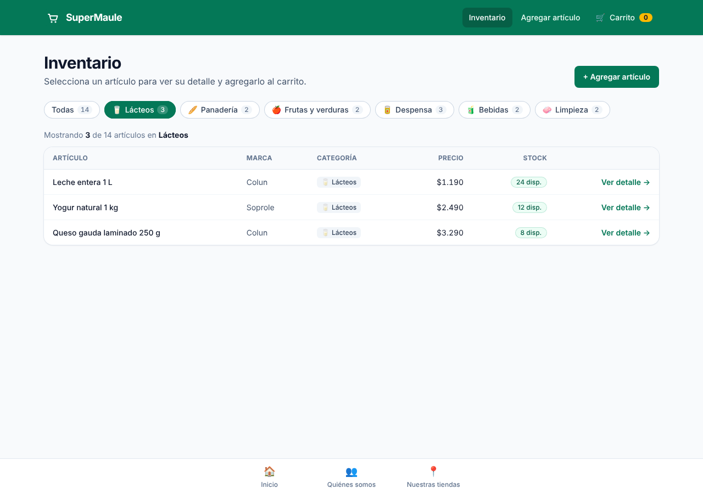
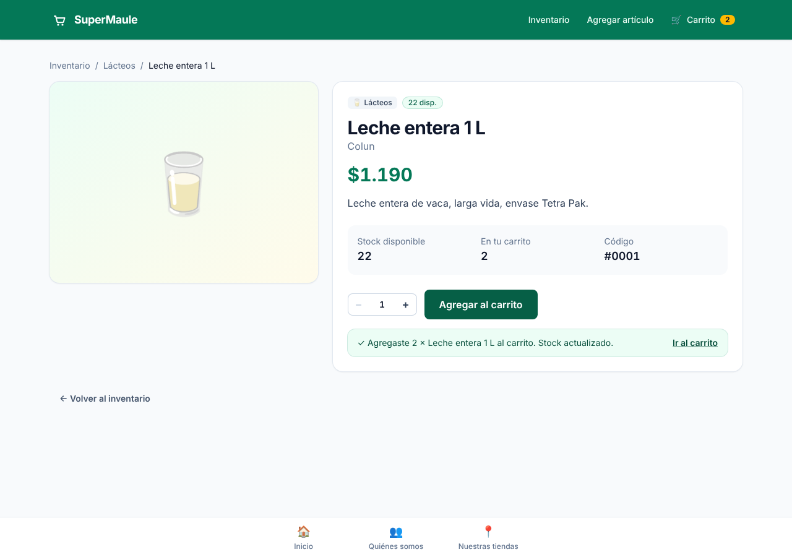
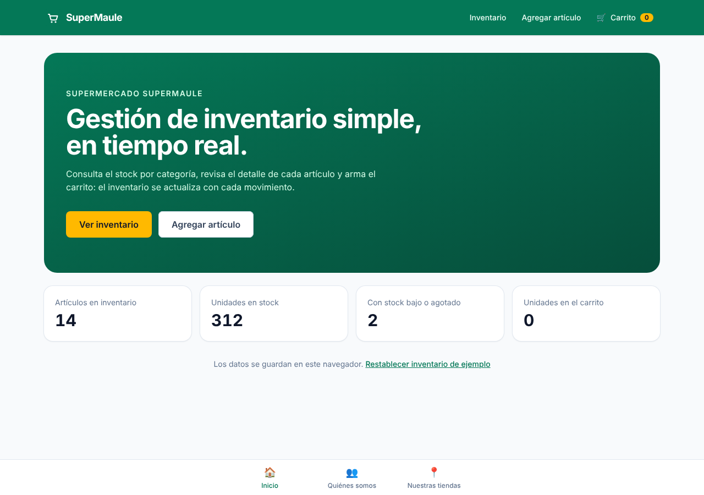
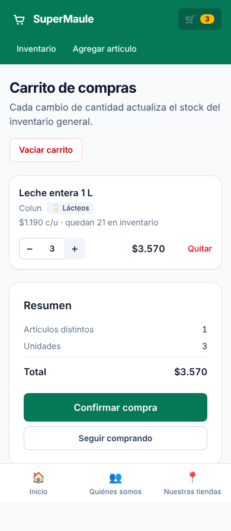

# 🛒 SuperMaule — Gestión de inventario de supermercado

Sitio web en **React** para gestionar el inventario de un supermercado: listado filtrable por categoría, alta de artículos, detalle de cada artículo y carrito de compras que **descuenta y devuelve stock del inventario en tiempo real**.

> **Asignatura:** Desarrollo Frontend II (PFY2202) — Duoc UC
> **Actividad:** Semana 3 · Evaluación sumativa «Desarrollando sitios web con React avanzado»
> **Autor:** Ignacio Miño Astorga

🔗 **Sitio publicado (gh-pages):** https://ign14.github.io/supermercado-ignacio-mino-pfy2202/

---

## Funcionalidades

| Semana | Funcionalidad | Ruta |
|---|---|---|
| S1 | Home + menú inferior con React Router (Inicio · Quiénes somos · Nuestras tiendas) | `/`, `/quienes-somos`, `/nuestras-tiendas` |
| S2 | Menú de gestión + estado global con la lista de artículos (nombre, marca, tipo) | — |
| S2 | Formulario para agregar artículos al inventario (con validación) | `/inventario/nuevo` |
| S2 | Tabla con todos los artículos del inventario | `/inventario` |
| **S3** | **Filtro por categoría** que actualiza el estado sin perder los datos originales | `/inventario?categoria=Lácteos` |
| **S3** | **Detalle del artículo** al hacer clic, con selector de cantidad y «Agregar al carrito» (resta stock) | `/inventario/:id` |
| **S3** | **Carrito de compras**: aumentar / disminuir / quitar / vaciar, actualizando el inventario general | `/carrito` |
| **S3** | Estilos con **Tailwind CSS v4**, diseño responsive (tabla en escritorio, tarjetas en móvil) | — |

### Capturas

| Inventario filtrado | Detalle del artículo |
|---|---|
|  |  |

| Inicio | Carrito (móvil) |
|---|---|
|  |  |

---

## Tecnologías

- **React 19** + **Vite** — SPA con componentes funcionales y hooks.
- **React Router 7** (`HashRouter`) — navegación entre pantallas; el hash evita errores 404 al recargar en GitHub Pages.
- **Context API + `useReducer`** — estado global del inventario y del carrito.
- **Tailwind CSS v4** — framework CSS utilitario, con paleta de marca definida en `@theme`.
- **Vitest** — pruebas unitarias de la lógica de inventario.
- **gh-pages** — publicación del build en GitHub Pages.

---

## Cómo funciona el estado (criterios 2 y 4 de la pauta)

El estado global vive en `src/context/` y tiene dos partes:

```js
{
  productos: [{ id, nombre, marca, categoria, precio, stock, descripcion }],
  carrito:   [{ id, cantidad }]   // solo referencias, sin duplicar datos
}
```

**Filtro sin perder datos.** La categoría seleccionada se guarda en la URL (`useSearchParams`) y la lista visible se **deriva** con `useMemo` + `Array.filter`, que devuelve un arreglo nuevo. El arreglo `productos` del estado global nunca se modifica al filtrar; al volver a «Todas» se ve el inventario completo.

**Inventario ↔ carrito siempre sincronizados.** Todas las modificaciones pasan por el reducer (`inventarioReducer.js`), que mueve unidades entre ambos en **una sola acción**:

| Acción | Inventario | Carrito |
|---|---|---|
| `AGREGAR_AL_CARRITO` (desde el detalle) | `stock − n` | `cantidad + n` |
| `INCREMENTAR` (+ en el carrito) | `stock − 1` | `cantidad + 1` |
| `DECREMENTAR` (− en el carrito) | `stock + 1` | `cantidad − 1` (se elimina en 0) |
| `QUITAR_DEL_CARRITO` / `VACIAR_CARRITO` | devuelve todo | se elimina |
| `CONFIRMAR_COMPRA` | se mantiene descontado | se vacía |

No se puede agregar más de lo disponible: el botón `+` se deshabilita al llegar a stock 0 y el reducer rechaza la operación. El estado se guarda en `localStorage`, así que sobrevive a recargas (en Inicio hay un enlace para restablecer los datos de ejemplo).

---

## Estructura del proyecto (criterio 6)

```
src/
├── App.jsx                     # Definición de rutas
├── main.jsx                    # HashRouter + InventarioProvider
├── index.css                   # Tailwind + tokens de marca
├── context/
│   ├── InventarioContext.jsx   # Provider + hook useInventario()
│   ├── inventarioReducer.js    # Lógica pura de inventario y carrito
│   └── inventarioReducer.test.js
├── data/
│   ├── categorias.js           # Categorías e iconos
│   └── productosIniciales.js   # Inventario de ejemplo
├── utils/formato.js            # Formato CLP y estado de stock
├── components/
│   ├── layout/                 # Layout, MenuSuperior (S2), MenuInferior (S1)
│   ├── ui/                     # Reutilizables: Boton, Tarjeta, BadgeStock, BadgeCategoria,
│   │                           #   ControlCantidad, EncabezadoPagina, EstadoVacio
│   ├── productos/              # FiltroCategoria, TablaProductos, FormularioProducto
│   └── carrito/                # LineaCarrito
└── pages/                      # Una página por ruta
```

Ejemplos de reutilización: `ControlCantidad` se usa en el detalle y en el carrito; `BadgeStock`/`BadgeCategoria` en la tabla, el detalle y el carrito; `EstadoVacio` en inventario sin resultados, carrito vacío, artículo inexistente y 404.

---

## Instalación y uso

Requisitos: **Node.js 18+** y npm.

```bash
git clone https://github.com/Ign14/supermercado-ignacio-mino-pfy2202.git
cd supermercado-ignacio-mino-pfy2202
npm install
npm run dev        # servidor local en http://localhost:5173
npm test           # pruebas unitarias (Vitest)
npm run build      # build de producción en /dist
```

### Publicar en GitHub Pages

```bash
npm run deploy     # compila y sube /dist a la rama gh-pages
```

Luego, en GitHub: **Settings → Pages → Source: Deploy from a branch → `gh-pages` / root**.

---

## Pauta de evaluación — dónde revisar cada criterio

| # | Criterio | Implementación |
|---|---|---|
| 1 | Pantalla de listado | `pages/Inventario.jsx`, `components/productos/TablaProductos.jsx` |
| 2 | Filtro con actualización dinámica del estado | `pages/Inventario.jsx`, `components/productos/FiltroCategoria.jsx` |
| 3 | Pantalla de detalle con interacción | `pages/DetalleProducto.jsx` |
| 4 | Modificación que actualiza el inventario | `context/inventarioReducer.js`, `pages/Carrito.jsx` (+ 7 tests) |
| 5 | Framework CSS responsive | Tailwind CSS v4 en todos los componentes (`index.css`, `vite.config.js`) |
| 6 | Código modular y reutilizable | Estructura `components/ui`, `layout`, `productos`, `carrito`, `pages`, `context` |
| 7 | GitHub + documentación + gh-pages | Este README, script `npm run deploy` |
